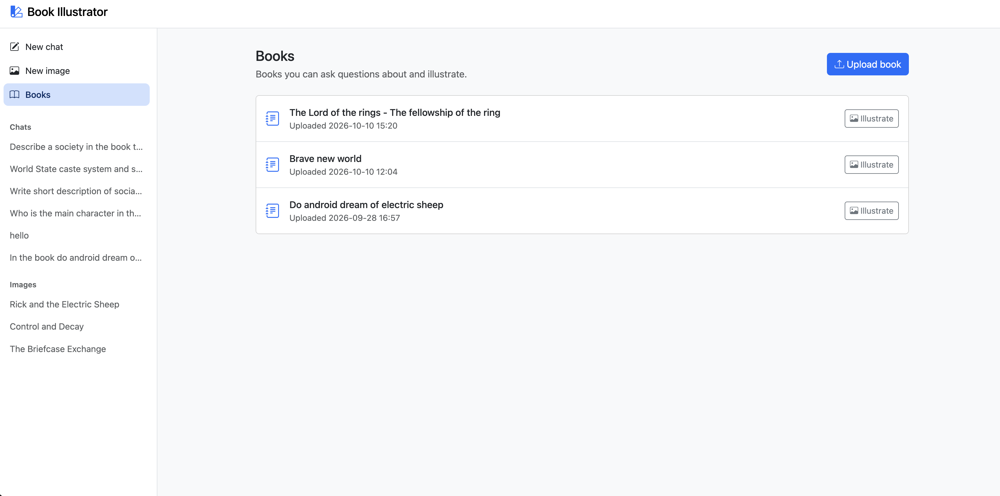
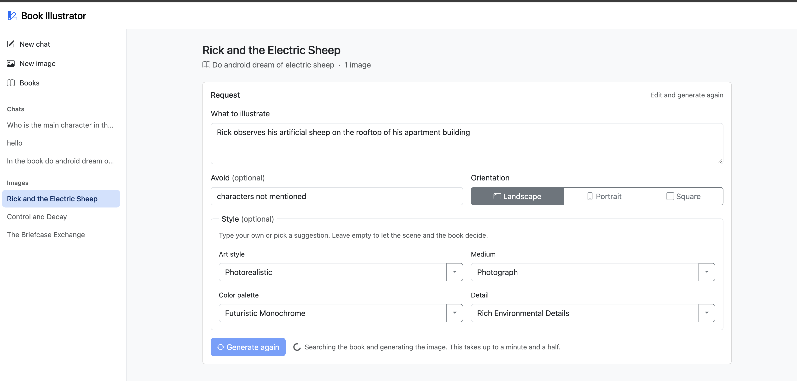
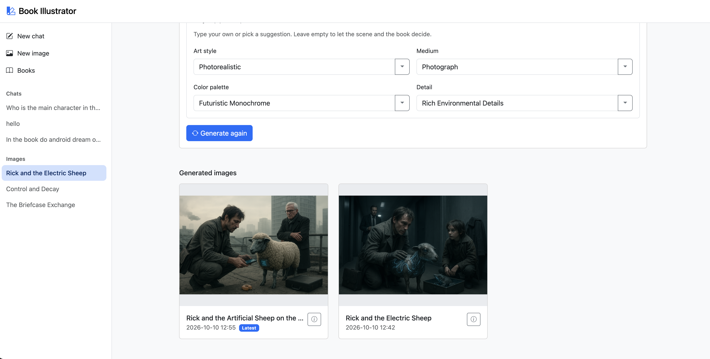
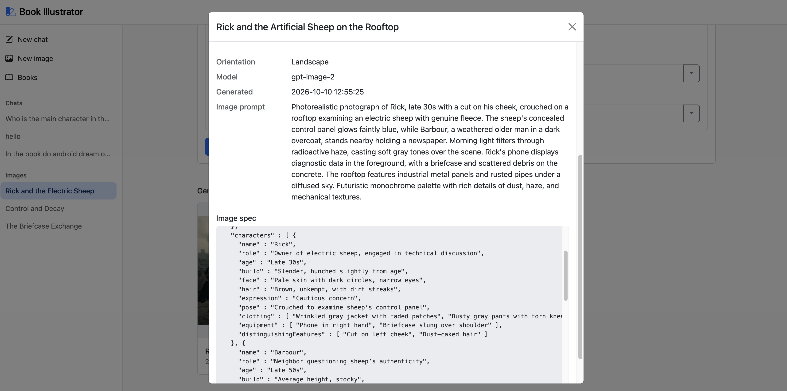
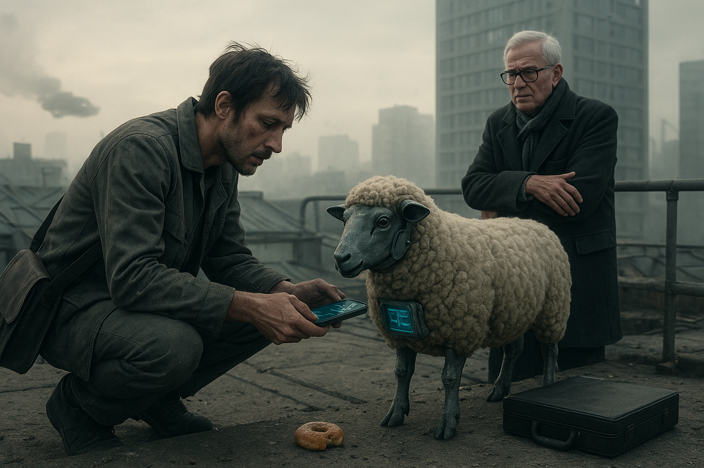
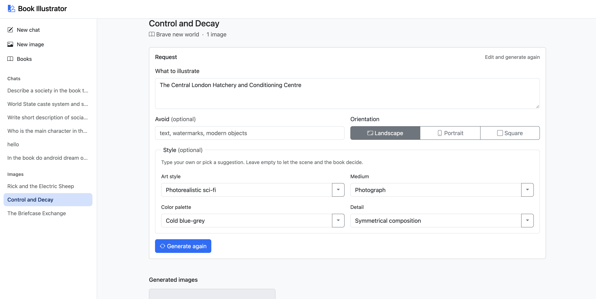
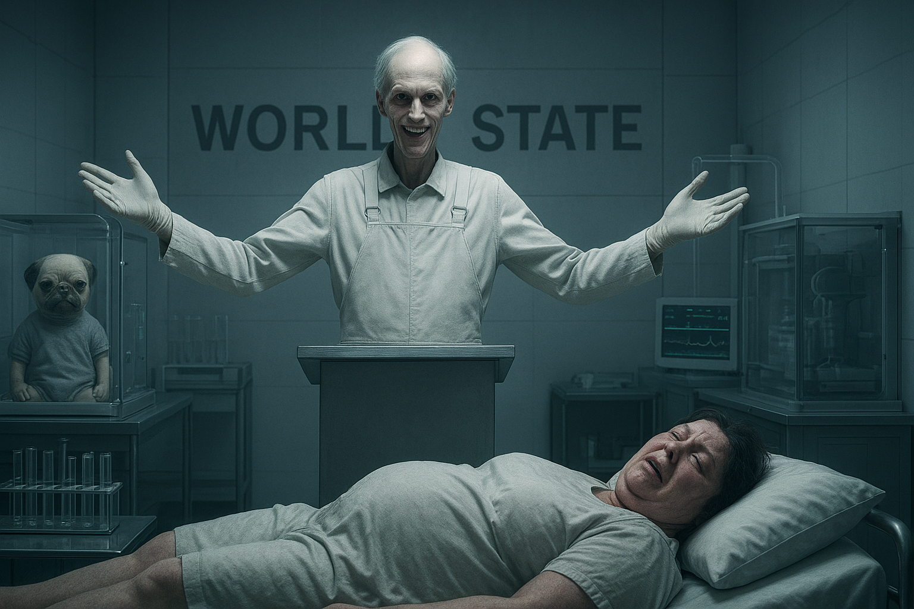
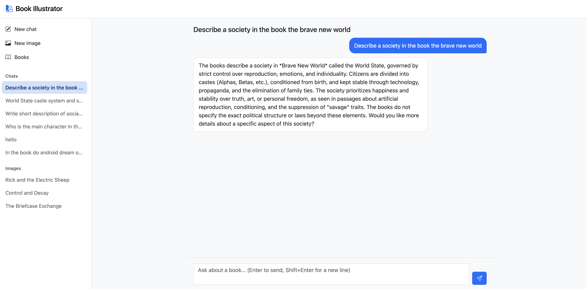

# Book Illustrator

Book Illustrator generates illustrations from a written source, such as a novel in PDF. You describe a scene or a character in a few words, and it produces an image that matches what the text says about the people, places and objects in it.

**The problem it solves.** An image model knows nothing about a particular book. Ask it for "Rick and his electric sheep" and it invents the characters' faces, clothes, the place and the mood, so the picture doesn't match the story. Book Illustrator first finds the relevant passages in the book, collects the visual details the author wrote, and turns them into a detailed image specification. Only then does it ask the image model to draw.

**How.** The project uses Retrieval-Augmented Generation (RAG): the book is indexed in a vector database, the passages relevant to each request are retrieved, and the LLM is told to rely on them instead of its own knowledge. A local LLM (Ollama) does the reading and reasoning, pgvector stores the book text, and OpenAI draws the image.

A simple chat about the uploaded books is also included. It uses the same book search and serves mainly as a tool for testing the retrieval.

## Tech stack

| Area          | Technology                                                                 |
|---------------|----------------------------------------------------------------------------|
| Language      | Java 25                                                                    |
| Framework     | Spring Boot 4.1, Spring AI 2.0 (RAG advisors, tool calling, structured output) |
| LLM           | Ollama with `qwen3:8b` (chat and reasoning), running locally               |
| Embeddings    | Ollama with `nomic-embed-text-v2-moe` (768 dimensions)                     |
| Images        | OpenAI text to image model, i.e. `gpt-image-2`                             |
| Storage       | PostgreSQL 17 with pgvector (book chunks, chats, images)                   |
| PDF parsing   | Apache PDFBox                                                              |
| UI            | Thymeleaf, htmx, Bootstrap                                                 |
| Observability | Actuator, Micrometer, Prometheus, Loki, Grafana                            |
| Build and run | Maven, Docker, Docker Compose                                              |

## Requirements

- Docker with Docker Compose. Java, Postgres and Ollama all run in containers.
- An OpenAI API key (`OPENAI_API_KEY`). It is used only to draw images; chat works without it.
- About 8 GB of free RAM and 10 GB of disk space for the local models

## Main use cases

1. **Upload a book**: add a PDF to the library and make it searchable.
2. **Illustrate a scene** (main feature): describe a moment or a character and get a picture that is faithful to the book.
3. **Chat about books** (testing tool): ask questions to check what the search finds in a book.

## How RAG works here

RAG has two halves, and every feature uses both:

- **Indexing**, done once per book: the text is cut into small pieces ("chunks"), and each piece is turned into an *embedding*, a list of numbers that captures its meaning. Pieces with similar meaning get similar numbers.
- **Retrieval**, done on every request: the request is turned into an embedding too, and the database returns the pieces whose meaning is closest to it. The LLM then works only with these pieces, not with its own memory of the book.

How good the result is depends mostly on *what the search asks for*. A raw user request is often a poor search query: it can be in another language, too short ("society"), mix in words that are not in the book ("watercolor", "wide shot"), or depend on earlier messages. So each feature prepares its queries before searching and cleans up the results after it.

## 1. Upload a book



On the **Books** page, click **Upload book** and pick a PDF with a title.


**Indexing flow**

1. The book is saved to the `books` table.
2. PDFBox extracts the text.
3. The text is split into chunks of about 100 tokens (a few sentences each). Small chunks make the search precise: a hit points at the exact sentences that mention a character's coat or a room's light.
4. Each chunk is tagged with metadata:
   - `bookId` and `bookTitle`, so a search can be limited to one book;
   - `chunkIndex`, the chunk's position in the book, so the text before and after any hit can be restored later.
5. Each chunk is embedded with `nomic-embed-text-v2-moe` (768 numbers) and stored in PostgreSQL with pgvector.

## 2. Illustrate a scene

Open **New image**, or click **Illustrate** next to a book, and fill in the form:

| Field                | Required | What to enter                                    |
|----------------------|----------|--------------------------------------------------|
| What to illustrate   | yes      | A scene or a character, in your own words        |
| Avoid                | no       | What must not appear in the image                |
| Orientation          | yes      | Landscape (default), portrait or square          |
| Style                | no       | Art style, medium, color palette and detail      |

Each request opens an **image thread**. You can edit the request and click **Generate again**; every result stays in the thread with the full spec that produced it.

**What happens**

Your text is not sent straight to the image model. The system first searches the book and writes an **image spec**: a JSON brief with the scene, every character's appearance, the environment, the composition, the style and a final prompt. Every visual detail in it comes from the book, or is listed under `assumptions` when the book doesn't say.

The work goes through four phases and ten steps:

```
 QUERY       ① Normalize -> ② Separate story from picture -> ③ Rephrase the scene ->
                                                                    
 SEARCH      ④ Search the scene -> ⑤ Find who is in it -> ⑥ Search each character ->
                                                                    
 CONTEXT     ⑦ Restore surrounding text -> ⑧ Extract visual facts ->
                                                                    
 GENERATION  ⑨ Write the image spec -> ⑩ Draw the image
```

| #  | Phase      | Step                         | What happens, in plain words                                                                                                                                                         | How it works                                                                                                                                                         |
|----|------------|------------------------------|--------------------------------------------------------------------------------------------------------------------------------------------------------------------------------------|----------------------------------------------------------------------------------------------------------------------------------------------------------------------|
| 1  | Query      | Normalize                    | Your request, style and "avoid" list are translated to English, because the book is searched in English. The style is reworded in precise art terms, without changing your choice. | LLM call with structured output (`NormalizedImageRequest`), validated and retried on bad JSON. Values you typed always win over the LLM's version.                  |
| 2  | Query      | Separate story from picture  | The system keeps only what to look for in the book: the event, place and actions, plus the characters you named. Words about the picture, like "photorealistic" or "close-up", are left out because the book never uses them. | LLM call returns `SceneIntent`: a scene query and a list of names. If there is neither, the request stops.                                                          |
| 3  | Query      | Rephrase the scene           | The scene is described in 3 more ways. One wording can miss the right page; four wordings of the same moment are much more likely to find it.                                       | Multi-query expansion (Spring AI `MultiQueryExpander`): 3 variants plus the original.                                                                                |
| 4  | Search     | Search the scene             | Each of the 4 descriptions is looked up in the selected book. The best results of all four are combined, taking turns, so no single wording takes over.                             | Vector similarity search in pgvector, filtered by `bookId`, top 5 per query. Results are merged round-robin and deduplicated.                                        |
| 5  | Search     | Find who is in the scene     | The system reads the found text and lists the characters who take part in this moment, including ones you didn't name.                                                              | Neighboring chunks are loaded around each hit, then an LLM call returns the names, at most 4. They are merged with the names from step 2.                           |
| 6  | Search     | Search each character        | Scene text rarely describes what people look like, so each character gets a separate search for their appearance.                                                                  | One query per character: *"Physical appearance, face, clothing and belongings of `<name>`"*.                                                                         |
| 7  | Context    | Restore surrounding text     | A found piece is only a few sentences long and often stops mid-description. The sentences before and after it are added back, so the descriptions are complete.                    | Context window expansion: chunks next to each hit are loaded by `chunkIndex`, and touching chunks are merged into continuous passages, up to 24 chunks.             |
| 8  | Context    | Extract visual facts         | From all the found text, the system writes down only what an illustrator needs: how people look, the place, the objects, the mood and the event. It adds nothing of its own.        | LLM call that condenses the passages into five headings: CHARACTERS, SETTING, OBJECTS, ATMOSPHERE, EVENT. This keeps the next prompt short and drops plot and dialogue. |
| 9  | Generation | Write the image spec         | An "art director" turns the facts and your settings into a detailed brief. Book facts come first. Anything the book doesn't say is chosen to fit the story and listed as an assumption. | LLM call with structured output (`ImageSpec`), validated against a JSON schema and retried if it doesn't match. Your style is copied word for word.                  |
| 10 | Generation | Draw the image               | The brief is sent to the image model, which draws the picture in the chosen orientation. The image and its brief are saved in the thread.                                          | OpenAI `gpt-image-2`. Size by orientation: landscape 1536×1024, portrait 1024×1536, square 1024×1024. The PNG is stored in Postgres.                               |

If the book has no matching scene or characters, the request stops with a clear message instead of producing a made-up picture.

### Example: "Rick and the Electric Sheep"

*Do Androids Dream of Electric Sheep?*

Request: *"Rick observes his artificial sheep on the rooftop of his apartment building"*
- Avoid: *"characters not mentioned"*
- Style: Photorealistic, Photograph, Futuristic Monochrome, Rich Environmental Details



The scene search found Rick's neighbor Barbour on the rooftop too, so he appears in the spec and in the image:



Every generated image keeps its prompt and full image spec:





<details>
<summary>Full image spec (JSON)</summary>

```json
{
  "title" : "Rick and the Artificial Sheep on the Rooftop",
  "orientation" : "landscape",
  "scene" : {
    "description" : "Rick kneels on a rooftop, adjusting the control panel of his electric sheep while Barbour leans against the railing. Morning light filters through radioactive haze, illuminating the mechanical details of the sheep and Rick’s weathered appearance.",
    "action" : "Rick demonstrates the electric sheep’s control panel to skeptical neighbor Barbour",
    "mood" : "Somber tension between technological marvel and human skepticism"
  },
  "characters" : [ {
    "name" : "Rick",
    "role" : "Owner of electric sheep, engaged in technical discussion",
    "age" : "Late 30s",
    "build" : "Slender, hunched slightly from age",
    "face" : "Pale skin with dark circles, narrow eyes",
    "hair" : "Brown, unkempt, with dirt streaks",
    "expression" : "Cautious concern",
    "pose" : "Crouched to examine sheep’s control panel",
    "clothing" : [ "Wrinkled gray jacket with faded patches", "Dusty gray pants with torn knees" ],
    "equipment" : [ "Phone in right hand", "Briefcase slung over shoulder" ],
    "distinguishingFeatures" : [ "Cut on left cheek", "Dust-caked hair" ]
  }, {
    "name" : "Barbour",
    "role" : "Neighbor questioning sheep’s authenticity",
    "age" : "Late 50s",
    "build" : "Average height, stocky",
    "face" : "Ruddy skin with deep wrinkles",
    "hair" : "White, short and neat",
    "expression" : "Skeptical scrutiny",
    "pose" : "Leaning against rooftop railing",
    "clothing" : [ "Dark overcoat with brass buttons", "Gray scarf" ],
    "equipment" : [ "Folded newspaper in left hand" ],
    "distinguishingFeatures" : [ "Square glasses with cracked lenses" ]
  } ],
  "environment" : {
    "location" : "Rooftop of 12-story building",
    "era" : "Near-future 2045 with hovercar infrastructure",
    "timeOfDay" : "Morning with soft golden-gray light",
    "weather" : "Radioactive haze creating light diffusion",
    "lighting" : "Diffused morning light through radioactive haze",
    "terrain" : "Concrete slabs with scattered debris",
    "vegetation" : "No visible plant life",
    "architecture" : "Modernist apartment building with glass-and-steel facade",
    "props" : [ "Electric sheep with fleece texture", "Hovercar exhaust plume in distance", "Phone displaying diagnostic readouts" ]
  },
  "composition" : {
    "shotType" : "Medium shot framing both characters",
    "cameraAngle" : "Low angle emphasizing rooftop height",
    "focalPoint" : "Rick’s hand adjusting control panel interface",
    "foreground" : "Briefcase and half-eaten donut on concrete edge",
    "background" : "Industrial rooftop with faded blue tarps and rusted pipes"
  },
  "style" : {
    "style" : "Photorealistic",
    "medium" : "Photograph",
    "colorPalette" : "Futuristic Monochrome",
    "detail" : "Rich Environmental Details"
  },
  "prompt" : "Photorealistic photograph of Rick, late 30s with a cut on his cheek, crouched on a rooftop examining an electric sheep with genuine fleece. The sheep's concealed control panel glows faintly blue, while Barbour, a weathered older man in a dark overcoat, stands nearby holding a newspaper. Morning light filters through radioactive haze, casting soft gray tones over the scene. Rick's phone displays diagnostic data in the foreground, with a briefcase and scattered debris on the concrete. The rooftop features industrial metal panels and rusted pipes under a diffused sky. Futuristic monochrome palette with rich details of dust, haze, and mechanical textures.",
  "negativePrompt" : "unmentioned characters",
  "assumptions" : [ "Barbour’s appearance inferred as an older man with a weathered face and a trench coat to match the setting’s tone", "Rooftop structure assumed to have industrial metal panels and a slight incline for practicality", "Electric sheep’s control panel designed with minimalist futuristic interface elements", "Radioactive haze visualized as thin, diffused particles floating in the air" ]
}
```

</details>

### Example: "Control and Decay"

*Brave New World*

Request: *"The Central London Hatchery and Conditioning Centre"*
- Avoid: *"text, watermarks, modern objects"*
- Style: Photorealistic sci-fi, Photograph, Cold blue-grey, Symmetrical composition





<details>
<summary>Full image spec (JSON)</summary>

```json
{
  "title" : "Control and Decay",
  "orientation" : "landscape",
  "scene" : {
    "description" : "A sterile white room features a towering Director gesturing to scientific equipment, while Linda lies motionless on a hospital bed. A pug-faced twin is suspended in an incubator, and medical monitors track vital signs. Cold blue light highlights the oppressive atmosphere of genetic control.",
    "action" : "Director demonstrates reproductive technology while Linda dies in her final moments",
    "mood" : "Oppressive and fearful"
  },
  "characters" : [ {
    "name" : "Director",
    "role" : "Demonstrating reproductive technology",
    "age" : "60-70 years",
    "build" : "Tall, thin, upright",
    "face" : "Elongated, with pale, corpse-colored skin",
    "hair" : "Thin, silver strands",
    "expression" : "Menacing geniality",
    "pose" : "Standing at a podium with arms spread wide",
    "clothing" : [ "White overalls", "Pale rubber gloves" ],
    "equipment" : [ "Clipboard with blueprints" ],
    "distinguishingFeatures" : [ "Long chin", "Prominent teeth", "Floridly curved lips" ]
  }, {
    "name" : "Linda",
    "role" : "Dying in her final moments",
    "age" : "44 years",
    "build" : "Fat, distended, flaccid",
    "face" : "Reddened and sweaty",
    "hair" : "Unkempt and greasy",
    "expression" : "Terrified gasps",
    "pose" : "Lying motionless with labored breathing",
    "clothing" : [ "White hospital pajamas" ],
    "equipment" : [ "Hospital bed" ],
    "distinguishingFeatures" : [ "Bad teeth", "Blotched complexion" ]
  }, {
    "name" : "Pug-faced twin",
    "role" : "Genetically engineered infant",
    "age" : "Unknown",
    "build" : "Small, rounded",
    "face" : "Smooth and pale",
    "hair" : "Short and matted",
    "expression" : "Unfocused stare",
    "pose" : "Suspended in an incubator",
    "clothing" : [ "Grey hospital gown" ],
    "equipment" : [ "Medical monitor" ],
    "distinguishingFeatures" : [ "Flattened muzzle", "Wide-set eyes" ]
  } ],
  "environment" : {
    "location" : "Interior of the Conditioning Centre",
    "era" : "World State, A.F. 632",
    "timeOfDay" : "Morning",
    "weather" : "Cold, bleak",
    "lighting" : "Cold, harsh overhead lights with frozen blue shadows",
    "terrain" : "Indoor",
    "vegetation" : "None",
    "architecture" : "Glass and nickel equipment with sterile white walls",
    "props" : [ "Test-tubes", "Incubators", "World State motto", "Hospital bed", "Pug-faced twin", "Head Nurse" ]
  },
  "composition" : {
    "shotType" : "Wide shot",
    "cameraAngle" : "Eye level",
    "focalPoint" : "Director's outstretched arms and Linda's hospital bed",
    "foreground" : "Medical monitors and test-tubes",
    "background" : "Squat grey building with 34-story windows"
  },
  "style" : {
    "style" : "Photorealistic sci-fi",
    "medium" : "Photograph",
    "colorPalette" : "Cold blue-grey",
    "detail" : "Symmetrical composition"
  },
  "prompt" : "Photorealistic sci-fi scene of the Central London Hatchery's Conditioning Centre: Director stands at a podium with arms spread wide, gesturing to test-tubes and incubators while Linda lies motionless on a hospital bed with labored breathing, surrounded by medical monitors and a pug-faced twin in an incubator. Cold blue light casts harsh shadows across sterile white walls etched with the World State motto. Symmetrical composition emphasizes the oppressive atmosphere of genetic control and human decay.",
  "negativePrompt" : null,
  "assumptions" : [ "Director's hair is thin and silver, matching World State's emphasis on youth", "Linda's hospital pajamas are plain white with frayed edges", "Head Nurse wears a grey-and-white striped uniform with a name tag", "Pug-faced twin has a flattened muzzle and wide-set eyes", "Director's gloves are pale rubber with cracked seams", "Hospital bed has a metal frame and thin, white linens", "World State motto is etched in faded gold on the building" ]
}
```

</details>

## 3. Chat about books

> **Note:** the chat is a testing tool for the RAG search, not the main feature. It shows what the search finds in a book for a given question, which helps to tune the retrieval used for illustrations.

Open **New chat** and ask a question, in any language. Each chat keeps its history, so follow-up questions work too.



**What happens**

1. **Prepare the query.** The question is translated to English. A follow-up question is rewritten as a standalone one using the chat history (*"And the castes?"* becomes *"What are the castes in Brave New World?"*).
2. **Search in rounds.** The code first searches with the full question, so a broad question is never cut down to one word like "society". Then a small agent reads these first results and runs 2–3 more searches from other angles (social classes, government, family…), each a phrase of 5–15 words.
3. **Answer from the passages only.** The model answers in the user's language using only the found text. If the books don't cover the question, it says what they do say and asks a short clarifying question.

## How to run locally

```bash
export OPENAI_API_KEY=sk-...
docker compose up -d --build
```

This starts the app, Postgres with pgvector, Ollama, Prometheus, Loki and Grafana. On the first start, the `ollama-models` service downloads the two models (several GB), and the app waits for it to finish.

| Service    | URL                     |
|------------|-------------------------|
| App        | http://localhost:8080   |
| Grafana    | http://localhost:3000   |
| Prometheus | http://localhost:9090   |

Open http://localhost:8080, upload a PDF on the **Books** page, then create an image or start a chat.
